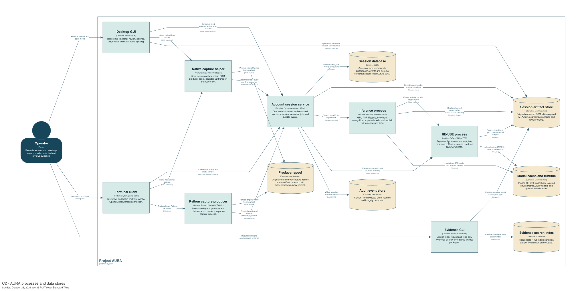

# Project AURA — C4 architecture

This package describes the current AURA implementation: desktop and terminal
controls, durable capture, GPU transcription, RE-USE enhancement, imported media,
audio splitting and evidence search. It is intended for maintainers, operators
and technical collaborators. All model labels, guides and exports are English.

Start with the [system context](../../../artifacts/architecture-c4/images/C1_Context.svg),
then the [container view](../../../artifacts/architecture-c4/images/C2_Containers.svg).
The [complete view catalog](view-catalog.md) links every SVG and PNG. The
[source ownership map](source-map.md) accounts for every application/native
source and the packaged glossary; its [JSON source](source-map.json) is checked
against the repository. Supporting setup, validation, packaging and CI files
are listed separately in the generated coverage receipt.



*AURA separates capture, account control, ASR and enhancement processes while preserving original audio and authoritative session state.*

## Browse and rebuild

```bash
make architecture-setup
make architecture-build
make architecture-check
make architecture-serve
```

Open `http://127.0.0.1:18080/?introduction=false`. Double-click a system,
container or component to navigate to its detailed views. When several views
are available, select one and press Enter. Use `+`/`-` to zoom, Space for quick
navigation, arrow keys to change views, and `i` for the diagram key. The viewer
runs in the foreground; Ctrl-C stops it. A different port is available through
`python3 scripts/architecture.py serve --port 18081`.

For a checkout on an SSH host, keep the viewer running there and forward it
with `ssh -L 18080:127.0.0.1:18080 gpu-host`; open the same localhost URL on
the client computer. Replace `gpu-host` with the configured SSH alias.

The build also writes `dist/aura-c4-architecture.zip`, containing the portable
interactive site, images, parsed workspace, source coverage and manifest.
Extract it and serve its `site/` directory with any local static HTTP server.
No Structurizr account or paid server is required. The interactive site contains
its JavaScript/CSS/images locally; initial viewing does not require an external
network. Source hyperlinks open GitHub only when selected.

For an explicit browser check and cached setup:

```bash
python3 scripts/architecture.py check --browser --json
python3 scripts/architecture.py setup --offline --json
```

`setup` verifies pinned download hashes. On Linux ARM64 it extracts Ubuntu Java
21 and Graphviz packages into ignored `runtime/architecture`; it changes no
system packages or AURA environments. Other Linux platforms use an installed
Java 21+ and Graphviz, optionally selected with `ARCHITECTURE_JAVA` and
`ARCHITECTURE_DOT`. Node.js 20+ and npm provide an isolated, lockfile-pinned
Playwright test dependency. Chromium is installed in the normal Playwright tool
cache on first setup if absent. The first setup needs network access; subsequent
builds reuse these tools. Missing libraries produce diagnostics rather than an
automatic system-package install. CI provisions Chromium's OS dependencies in
its disposable runner.

Commands report bounded stage progress on stderr. `--json` preserves stdout as
one result object. Failure logs stay in ignored `runtime/architecture/logs/`.
Interrupted subprocess groups are terminated; a render failure retains the
previous output package. An occupied viewer port is reported without stopping
another service.

## Reading the model

- **C1:** AURA, its operator, local audio services, model repositories and
  optional release metadata checks. Dashed provisioning/update links are
  separate from the local recording path.
- **C2:** Executable processes and logical data stores. The SDK, threads, model
  weights and FFmpeg helpers remain within their appropriate implementation or
  platform roles. A C4 container here does not mean a Docker container.
- **C3:** Eight focused process views cover desktop, terminal, Rust capture,
  Python capture, account service, inference, enhancement and evidence search.
  The same SDK library has distinct GUI, terminal and producer instances;
  ordinary library calls are not modeled as inter-process calls.
- **C4:** Nine source-generated views expand durable sessions, native transport,
  speech protection, health/gaps, recovery, file transcription, transcript
  review, splitting and evidence search. Python AST/native declarations supply
  actual symbols and public members. Curated dependency labels describe their
  responsibilities; static inspection does not claim an exhaustive call graph.
- **Dynamics:** Eight ordered scenarios cover live capture, suppression/repair,
  Stop/export, pause/reconnect, explicit stopped recovery, import/refinement,
  review/search and splitting.
- **Deployment:** Linux GB10, CPU client over SSH, and Windows source/runtime
  gates. Deployment placement describes process topology; it does not certify
  every device or platform as accepted.

SQLite state, canonical artifact files, original capture spools, model caches and
the rebuildable search index have different responsibilities. A raw ACK proves
original-frame durability; it does not prove usable enhancement, successful ASR
or permission to remove the producer spool. Capture completion and source
deletion are separate gates.

## Runtime contracts and evidence

Live recording persists original PCM, runs Real-time RE-USE, then enhanced VAD
and Breeze. Source VAD supplies protection/health evidence; original audio does
not bypass enhancement into ASR. The service health check and worker spectral
protection are separate components. Model state spans ASR chunks; an acknowledged
pause starts a new continuous interval. Bounded repair targets unsubmitted
missing ranges and preserves existing jobs and human edits.

Stop drains committed work and produces a final M4A from the complete original
through offline RE-USE, normalization, encoding and full decode validation.
Offline RE-USE does not consume the live-enhanced journal. Its reference frame
gate remains unchanged. Explicit import/refinement is a separate file job;
refinement uses the selected saved audio and writes separate refined output.

The [RE-USE architecture](../reuse-c4.md) owns thresholds and policy details.
The [October 18 incident](../../audit-events/2026-10-18-reuse-speech-guard/audit-event.md)
and [availability receipt](../../../artifacts/reuse-speech-guard-2026-10-18/validation.json)
preserve `availability_validation`, `LIVE_MINIMUM_COMPLETED` and
`valid_target_runtime`. Those measurements validate the exercised GPU path;
accuracy, denoising quality and latency remain `not_evaluated`. Pending review
intervals and retained originals remain authoritative.

Windows packaging/diagnostic source and optional Linux Parakeet are shown
with their activation boundaries. Default-on Nemotron runs in an isolated CUDA
worker; its [operating contract](../../nemotron-diarization.md) and
[validation packet](../../../artifacts/nemotron/README.md) distinguish the measured
pre-merge runtime from pending combined RE-USE/Nemotron live acceptance. The current RE-USE runtime uses Linux
environment paths; a Windows deployment view is not evidence of Windows RE-USE
availability. Physical amd64, second-host SSH and microphone acceptance retain
their existing gates. Historical summary-compatible artifacts can be searched;
the evidence CLI does not introduce a new summary, Agent or MCP runtime.

## Maintenance and ownership

`workspace.dsl` includes the hand-maintained model, deployments and views.
`code/catalog.json` selects important declarations and dependency stories;
`build` regenerates PlantUML, embedded code SVGs and the source/view catalogs.
Keep stable element and view identifiers when renaming labels. New source files
must be assigned to a real C3 owner or explicitly classified as compatibility,
retained or evaluation code. Shared library ownership is canonical rather than
exclusive: callers may load the same module into several processes.

The [artifact packet](../../../artifacts/architecture-c4/README.md) owns build and
browser evidence, source/tool identities and image hashes. AURA owns the model
and implementation detail. The [Planning day locator](https://github.com/JasonLn0711/planning-everything-track/blob/main/weeks/2026-W42/days/2026-10-18.md#aura-c4-2026-10-18)
holds status, capacity and the next maintenance action. This package adds no GPU
experiment, production restart, public hosting service or release tag.

Tool provenance: [Structurizr consolidated commands](https://docs.structurizr.com/getting-started),
[pinned binary requirements](https://docs.structurizr.com/binaries),
[local SVG/PNG export](https://docs.structurizr.com/export/png-and-svg),
[code-diagram guidance](https://c4model.com/diagrams/code), and
[PlantUML class diagrams](https://plantuml.com/class-diagram). Download URLs and
SHA-256 identities are preserved in `tools.lock.json`; licenses remain upstream.
