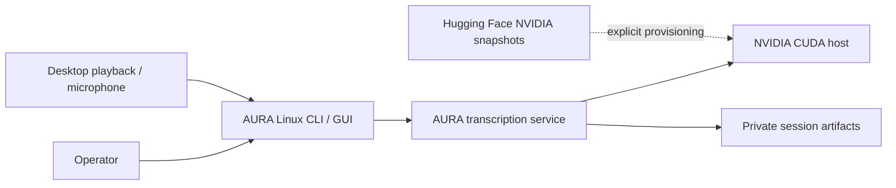
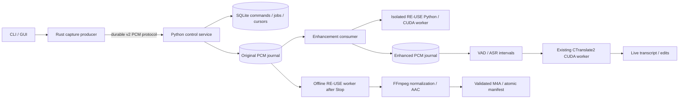
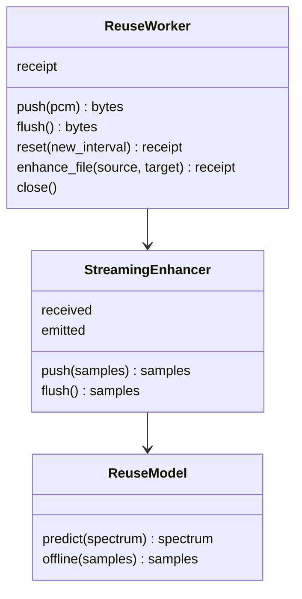

# AURA RE-USE architecture

Status: implemented. Both pinned models and five-minute public-audio capture
have executed successfully on GB10. The [availability packet](../../artifacts/reuse-availability-2026-10-17/README.md)
records Brave validation and account-service activation separately.
The latest user decision is authoritative: Stop enhances audio only. It does not
start a second full ASR pass. Live text and user edits remain authoritative.

The [speech-guard validation receipt](../../artifacts/reuse-speech-guard-2026-10-18/validation.json)
records functional GPU replay, idle activation and native capture completion.
Flagged intervals retain original audio for review; accuracy and denoising
quality remain `not_evaluated`.

The [October 18 incident record](../audit-events/2026-10-18-reuse-speech-guard/audit-event.md)
connects the supplied decisions, before/after behavior, validation and Planning
closeout. Live speech protection changes the real-time adapter only; offline
RE-USE retains its pinned reference denoising algorithm and frame gate.

## C1 — System context



*Operators capture on ARM64 or amd64 Linux; inference belongs to the CUDA host.*

CPU devices support capture, transport and controls. They do not run RE-USE or
GPU-only ASR locally. Model downloads occur during provisioning, never recording.
NVIDIA model implementation and weights retain their upstream noncommercial
license. The adopted operating scope is personal research, not commercial use.

## C2 — Containers and deployment



*Separate environments preserve the custom CTranslate2 CUDA 13 runtime while
RE-USE owns its PyTorch and Mamba dependencies.*

The service owns raw persistence and acknowledgements. Enhancement consumes that
journal independently. Only one continuous interval is processed at a time;
model state crosses ASR segments and resets at an acknowledged pause boundary.
A source-aligned suppression guard can also reset hidden model state without
resetting the STFT or source clock. Network reconnection does not reset model
state. Excess work stays on disk.

## C3 — Components and persistence

| Owner | Responsibility | Persistent evidence |
| --- | --- | --- |
| Rust capture | Capture, local spool, reconnect, final sequence | Producer journal |
| Stream protocol | Ownership, raw durability, replay conflict detection | Durable raw cursor |
| Enhancement consumer | Stateful replay, enhanced PCM, VAD, job deduplication | Enhanced cursor and pause boundaries |
| ASR scheduler | GPU jobs and live result publication | Jobs, segments, live.txt |
| Export worker | Original audio → offline RE-USE → AAC | Model revision and processing receipt |
| Retention | Validate, publish, then remove registered working audio | Manifest and cleanup pending list |

On failure, preserve original audio and report the failing stage. Never silently
substitute an enhancement model or pass unenhanced audio to ASR. Recovery replays
an interrupted interval to reconstruct hidden model state and skips committed
ASR intervals. Export retries do not request ASR. Historical sessions and audit
evidence retain their original interpretation; migration affects new settings.

### Speech suppression and recovery

New sessions freeze a `speech-guard-v1` live policy. Existing sessions without a
policy keep `reference-v1`, including during explicit recovery. Operators can
set `AURA_LIVE_ENHANCEMENT_POLICY=reference-v1` before starting an idle service
to restore the reference default for subsequent sessions. This does not migrate
existing recordings. The additive `live_enhancement_guard` capability advertises
support; `enhancement.policy`, the worker receipt and the delivery manifest
identify the policy actually used.

An independent source VAD classifies each durable 30 ms input packet before
enhancement. Speech with RMS of at least 80 PCM16 units protects the corresponding
source interval and a 320 ms hangover. The worker intersects that evidence with
each centered 640-sample STFT window. Padding does not create speech evidence,
and a fresh pause interval clears evidence along with the model and transform.

The pinned reference adapter clears an entire frame when more than half its
predicted magnitude bins are zero. For protected windows, `speech-guard-v1`
retains the model's surviving nonnegative magnitude bins and predicted phase.
Unprotected windows retain the reference gate. There is no original-audio mix,
gain floor or alternate denoiser. Native all-zero model output still requires
state recovery. Bounded counters distinguish native all-zero frames, reference
postfilter mutes and protected frames with surviving output.

This policy preserves the model's enhancement path. Functional replay establishes
signal and ASR availability; denoising quality and transcription accuracy remain
`not_evaluated` until a separately activated, reviewed quality evaluation.

The guard compares original and enhanced 30 ms frames at the same source sample
index. Its bounded three-second window requires at least one second of audible
source speech from an independent VAD, source RMS of at least 80 PCM16 units,
enhanced RMS below 8, and enhanced RMS below 1% of source RMS. Source silence and
unvoiced noise do not trigger a reset. Each suppression episode requests one
hidden-state reset. Continued suppression is reported as `blocked`; sustained
enhanced speech restores `healthy`. These are signal-availability checks, not
ASR accuracy or performance measurements.

`enhancement.health` and sample-indexed `enhancement.gaps` separate model
activity from usable output. A restored stream retains its pending historical
gap. CLI, GUI and inspection expose that gap, and delivery cleanup retains the
original until recovery succeeds. The recent no-speech warning also returns
after speech has previously been detected.

For guarded recordings, a newly detected episode schedules bounded live repair
after restoration or the continued-suppression event. One repair worker serves
the entire service. It yields when source backlog exceeds 16,000 samples and
resumes at 8,000 or fewer. Each missing interval is bounded by the session's ASR
segment limit and receives at most two fresh-state attempts: up to two seconds
of source context, then no context. Only usable enhanced output is fsynced and
submitted to ASR. Reservations and a final coverage check prevent overlap with
primary jobs; late results are ordered by source time and preserve human edits.

Already submitted ranges remain explicit review candidates. A parent episode
resolves only after it closes, all repair children complete with text, and no
submitted-range review remains. Failed repair retains pending gaps and original
audio while normal capture continues. `enhancement.live_repair_work` exposes
active, paused and queued work. Pause or Stop cancels unfinished repair and
prevents new repair submissions; committed ASR jobs drain normally. Stop does
not start a new recording-wide scan. Service restart does not automatically
reactivate historical gaps.

Native capture completes successfully once every captured frame is durable and
the export is ready, including sessions awaiting review. It retains its spool
until authenticated `delivery_committed` evidence permits cleanup. Pending
review therefore preserves audio without turning a finished recording into a
capture failure.

The isolated functional runner accepts `--live-policy`, `--continuous-replay`
and repeated `--require-segment-range START:END` arguments. Continuous SDK replay
keeps enhancement backlog within one second and waits for live repair before
Stop. Required ranges assert nonempty ASR availability, not transcript accuracy.

Stopped-recording recovery scans the complement of all existing ASR job ranges,
including interior holes. Original-audio VAD locates candidate speech; each
candidate passes through the same pinned live RE-USE model with fresh state and
up to two seconds of source context. VAD consumes that context before assessing
the target interval. Continued suppression gets one fresh-state retry without
context. Context output is discarded, and only the
missing enhanced interval goes to Breeze. Existing jobs, transcript segments
and human edits are preserved. Replay deduplicates overlapping job coverage,
not only identical chunk boundaries. An empty recovery ASR result or continued
suppression remains a pending issue with original audio retained.

The additive `recover_language` and `enhancement_recovery` capabilities identify
updated services. `recover` accepts an optional `language` argument for recovery
jobs; it leaves the recording's stored original options intact. Pending gaps
also live in the session manifest, so standalone delivery cleanup cannot bypass
the retention gate. Stop still drains live work and exports audio; it does not
launch a full recording ASR pass.

The inference safety watchdog measures export inactivity. Advancing offline
sample counts or encoding bytes extend its deadline; unchanged progress and
heartbeats do not. Long recordings can finish while stalled workers remain
bounded and their original audio stays recoverable.

## C4 — Code and interfaces



*The public worker interface hides CUDA dependencies from CPU clients. Sample
counts, rather than wall-clock estimates, define audio alignment and progress.*

The wire PCM contract is mono 16 kHz signed 16-bit, 480 samples per capture frame.
The live transform uses a periodic Hann window of 640 samples and a 320-sample
hop, centered reflect padding, overlap-add normalization and exact final length.
Very short intervals use explicit deterministic padding. Exit layer is 8,
look-ahead is 0, model precision is FP32. Padding does not advance capture time.

Offline inference reads the complete original source, including nonspeech.
It uses five-second windows with 50% overlap and the official final-window
placement. Accumulation holds at most five seconds in memory. It never takes
Real-time RE-USE output as its input. Normalization and clipping are separate
from enhancement. The delivery format remains 16 kHz mono AAC in an M4A file.

## Stop, commit and recovery

```mermaid
sequenceDiagram
  participant Producer
  participant Service
  participant Live as Real-time RE-USE
  participant ASR
  participant Offline as Offline RE-USE
  participant Store
  Producer->>Service: Final durable sequence and Stop acknowledgement
  Service->>Live: Drain original journal; flush final samples
  Live->>ASR: Remaining live intervals
  ASR->>Store: Persist live transcript, preserve edits
  Service->>Offline: Complete original recording
  Offline->>Store: Enhanced WAV scratch
  Service->>Store: Normalize, encode and validate temporary M4A
  Service->>Store: Atomic publication and manifest commit
  Service->>Store: Retryable registered-source cleanup
```

*Stop finishes pending live ASR, then prepares delivery audio without retranscribing
that enhanced audio. Failed enhancement or encoding leaves the original intact.*

Raw, enhancement and cleanup cursors have separate meanings. A raw ACK establishes
raw durability only. Producer spool deletion requires delivery commit evidence;
a disconnected producer waits for its next authenticated connection.

## Dependencies and activation gates

Pinned model snapshots:

- [Real-time RE-USE](https://huggingface.co/nvidia/Real-time_RE-USE/tree/4c0c186272ca853cd18d832fc5c28777b62f32d1)
- [RE-USE](https://huggingface.co/nvidia/RE-USE/tree/0ee310117ef0ae1e652654c821cf140bdcdc8415)

`runtime/reuse-venv` uses Python 3.12 and PyTorch/torchaudio 2.9.1 CUDA 13.
`python3 scripts/setup_reuse_runtime.py` provisions isolated dependencies and
records downloaded source and weight hashes. It does not activate the service.
Mamba and causal-conv1d require native extension validation on GB10. Upstream's
Triton 2.3 installation instruction is not applied to this CUDA 13 environment.

Acceptance requires both real models, real streaming output before Stop, valid
M4A after Stop, pause/reconnect/recovery, no duplicate ASR, and retained input on
failure. amd64 capture needs CI plus a physical remote-client acceptance run.
Accuracy and preprocessing efficacy remain `not_evaluated`. A framing fixture
or a mocked predictor establishes only its tested implementation layer.
