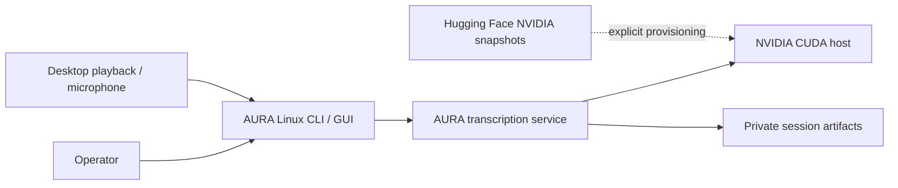
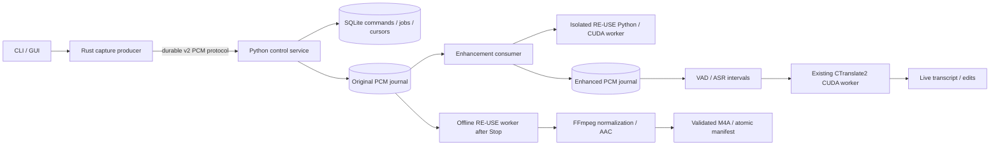
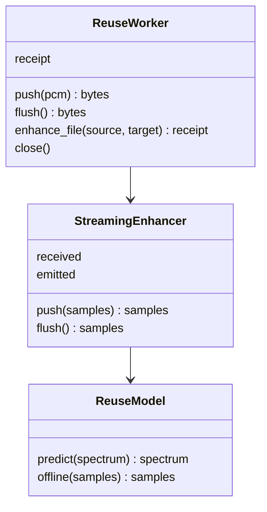

# AURA RE-USE architecture

Status: implemented. Both pinned models and five-minute public-audio capture
have executed successfully on GB10. The [availability packet](../../artifacts/reuse-availability-2026-10-17/README.md)
records Brave validation and account-service activation separately.
The latest user decision is authoritative: Stop enhances audio only. It does not
start a second full ASR pass. Live text and user edits remain authoritative.

## C1 — System context



*Operators capture on ARM64 or amd64 Linux; inference belongs to the CUDA host.*

CPU devices support capture, transport and controls. They do not run RE-USE or
GPU-only ASR locally. Model downloads occur during provisioning, never recording.
NVIDIA model implementation and weights retain their upstream noncommercial
license. The adopted operating scope is personal research, not commercial use.

## C2 — Containers and deployment



*Separate environments preserve the custom CTranslate2 CUDA 13 runtime while
RE-USE owns its PyTorch and Mamba dependencies.*

The service owns raw persistence and acknowledgements. Enhancement consumes that
journal independently. Only one continuous interval is processed at a time;
model state crosses ASR segments and resets at an acknowledged pause boundary.
Network reconnection does not reset model state. Excess work stays on disk.

## C3 — Components and persistence

| Owner | Responsibility | Persistent evidence |
| --- | --- | --- |
| Rust capture | Capture, local spool, reconnect, final sequence | Producer journal |
| Stream protocol | Ownership, raw durability, replay conflict detection | Durable raw cursor |
| Enhancement consumer | Stateful replay, enhanced PCM, VAD, job deduplication | Enhanced cursor and pause boundaries |
| ASR scheduler | GPU jobs and live result publication | Jobs, segments, live.txt |
| Export worker | Original audio → offline RE-USE → AAC | Model revision and processing receipt |
| Retention | Validate, publish, then remove registered working audio | Manifest and cleanup pending list |

On failure, preserve original audio and report the failing stage. Never silently
substitute an enhancement model or pass unenhanced audio to ASR. Recovery replays
an interrupted interval to reconstruct hidden model state and skips committed
ASR intervals. Export retries do not request ASR. Historical sessions and audit
evidence retain their original interpretation; migration affects new settings.

## C4 — Code and interfaces



*The public worker interface hides CUDA dependencies from CPU clients. Sample
counts, rather than wall-clock estimates, define audio alignment and progress.*

The wire PCM contract is mono 16 kHz signed 16-bit, 480 samples per capture frame.
The live transform uses a periodic Hann window of 640 samples and a 320-sample
hop, centered reflect padding, overlap-add normalization and exact final length.
Very short intervals use explicit deterministic padding. Exit layer is 8,
look-ahead is 0, model precision is FP32. Padding does not advance capture time.

Offline inference reads the complete original source, including nonspeech.
It uses five-second windows with 50% overlap and the official final-window
placement. Accumulation holds at most five seconds in memory. It never takes
Real-time RE-USE output as its input. Normalization and clipping are separate
from enhancement. The delivery format remains 16 kHz mono AAC in an M4A file.

## Stop, commit and recovery

```mermaid
sequenceDiagram
  participant Producer
  participant Service
  participant Live as Real-time RE-USE
  participant ASR
  participant Offline as Offline RE-USE
  participant Store
  Producer->>Service: Final durable sequence and Stop acknowledgement
  Service->>Live: Drain original journal; flush final samples
  Live->>ASR: Remaining live intervals
  ASR->>Store: Persist live transcript, preserve edits
  Service->>Offline: Complete original recording
  Offline->>Store: Enhanced WAV scratch
  Service->>Store: Normalize, encode and validate temporary M4A
  Service->>Store: Atomic publication and manifest commit
  Service->>Store: Retryable registered-source cleanup
```

*Stop finishes pending live ASR, then prepares delivery audio without retranscribing
that enhanced audio. Failed enhancement or encoding leaves the original intact.*

Raw, enhancement and cleanup cursors have separate meanings. A raw ACK establishes
raw durability only. Producer spool deletion requires delivery commit evidence;
a disconnected producer waits for its next authenticated connection.

## Dependencies and activation gates

Pinned model snapshots:

- [Real-time RE-USE](https://huggingface.co/nvidia/Real-time_RE-USE/tree/4c0c186272ca853cd18d832fc5c28777b62f32d1)
- [RE-USE](https://huggingface.co/nvidia/RE-USE/tree/0ee310117ef0ae1e652654c821cf140bdcdc8415)

`runtime/reuse-venv` uses Python 3.12 and PyTorch/torchaudio 2.9.1 CUDA 13.
`python3 scripts/setup_reuse_runtime.py` provisions isolated dependencies and
records downloaded source and weight hashes. It does not activate the service.
Mamba and causal-conv1d require native extension validation on GB10. Upstream's
Triton 2.3 installation instruction is not applied to this CUDA 13 environment.

Acceptance requires both real models, real streaming output before Stop, valid
M4A after Stop, pause/reconnect/recovery, no duplicate ASR, and retained input on
failure. amd64 capture needs CI plus a physical remote-client acceptance run.
Accuracy and preprocessing efficacy remain `not_evaluated`. A framing fixture
or a mocked predictor establishes only its tested implementation layer.
