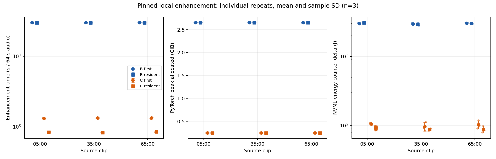
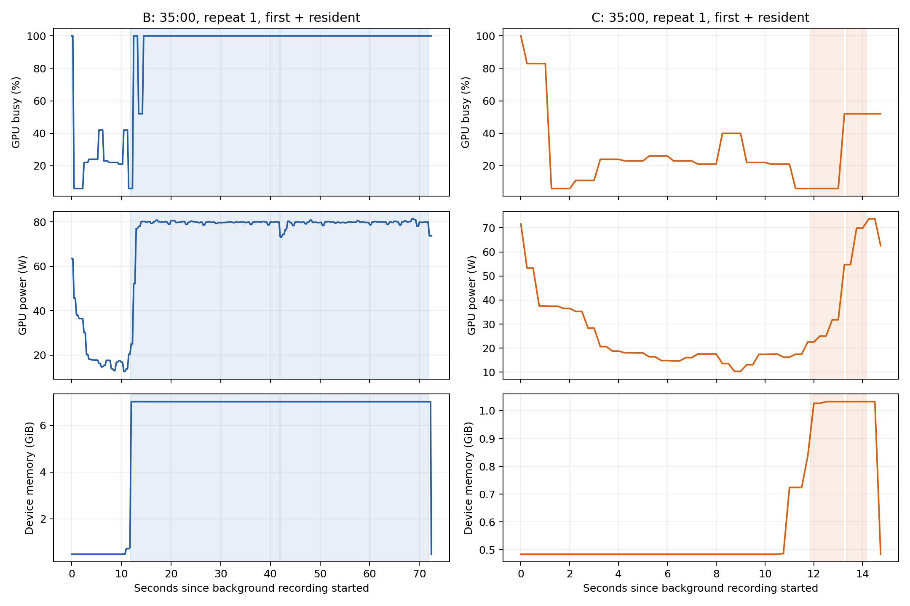

# Claude Meetup Yilan enhancement experiment — October 17, 2026

The reviewed recording has an adopted listening choice: **NVIDIA RE-USE (B)**.
The follow-up A/B/C experiment is `LIVE_FULL_COMPLETED` for three fixed clips.
The [aggregate receipt](../artifacts/yilan-enhancement-2026-10-17/receipt.json)
separates execution, runtime validity, validation and the human decision.

## FIRST PRINCIPLE and ownership

Scarce resources are evidence fidelity, listening attention and GPU execution
capacity. Project AURA owns the experiment and local evidence. Planning owns
status, capacity, publication receipts and the next decision. Jason supplied
the distant-microphone recording, requested comparison and complete telemetry,
and reported the human listening decision. Agent-executed inference and archive
checks are recorded separately from that human review.

## Source, sequence and decision

1. Three M4A sources were concatenated in order into approximately 78 minutes
   40 seconds; original files were preserved.
2. The initial pilot compared A original mono, B RE-USE, C ClearVoice
   MossFormer2_SE_48K and D RE-USE followed by ClearVoice at 05:00, 35:00 and
   65:00. It produced twelve valid listening M4As. That pilot did not capture
   continuous resource telemetry; historical GPU curves cannot be reconstructed.
3. Jason reported that RE-USE alone was sufficient. The preserved verbatim
   response and subsequent clarification are in the local
   `sources/user-requests.json`: the repeat includes A, B and C, excludes D,
   and retains the adopted human conclusion.
4. The repeat produced 36 valid formal inferences, four diagnostic inferences
   and four completed but excluded inferences from two failed workers. All
   36 formal outputs match the prior valid pilot sample-for-sample. Nine M4As
   were decoded and validated for duration, level matching and true peak.
5. A 530-file ZIP was delivered locally: 2,275,102,931 bytes; every member passed
   CRC and SHA-256 verification. Its receipt and full SHA-256 are in the linked
   aggregate packet. The original 373-file telemetry seal remains unchanged.

## Protocol and measured results

`STUDY-YILAN-001` / `EXP-20261017-02-yilan-telemetry` /
`DATA-YILAN-pilot-v1`: three 64-second inputs with two seconds of context on
both sides, cropped to 60 seconds; 48 kHz mono, 0.5 L + 0.5 R. Each B/C condition
has three fresh-worker repetitions with first and resident calls. RE-USE uses
five-second chunks, 50% overlap and no BWE. Models execute sequentially on an
RTX 4090 Laptop GPU; no parallel inference claim is made.

NVML and psutil were sampled every 250 ms. Formal coverage was 100%, with a
maximum observed interval of 0.276 seconds. CPU, memory, process/device GPU
memory, utilization, clocks, temperature, power, energy counter, I/O, phase
events and independent profiler traces remain in local custody. The following
values are medians of three technical repeats; RTF uses 64 seconds as denominator.

| 模型 | 片段 | 模式 | 推論秒數 | RTF | PyTorch 峰值 GiB | NVML 計數器 J |
|---|---|---|---:|---:|---:|---:|
| B | 05:00 | 首次 | 30.040 | 0.4694 | 2.656 | 3013.0 |
| B | 05:00 | 留駐 | 29.918 | 0.4675 | 2.656 | 3082.4 |
| B | 35:00 | 首次 | 30.065 | 0.4698 | 2.656 | 2975.6 |
| B | 35:00 | 留駐 | 29.837 | 0.4662 | 2.656 | 2881.6 |
| B | 65:00 | 首次 | 30.113 | 0.4705 | 2.656 | 3077.3 |
| B | 65:00 | 留駐 | 29.861 | 0.4666 | 2.656 | 3017.1 |
| C | 05:00 | 首次 | 1.311 | 0.0205 | 0.249 | 105.6 |
| C | 05:00 | 留駐 | 0.842 | 0.0132 | 0.249 | 93.4 |
| C | 35:00 | 首次 | 1.333 | 0.0208 | 0.249 | 92.9 |
| C | 35:00 | 留駐 | 0.832 | 0.0130 | 0.249 | 90.5 |
| C | 65:00 | 首次 | 1.340 | 0.0209 | 0.249 | 100.0 |
| C | 65:00 | 留駐 | 0.846 | 0.0132 | 0.249 | 86.0 |

[Machine-readable summary](../artifacts/yilan-enhancement-2026-10-17/analysis/summary.csv)
retains individual-condition descriptive statistics.

*Individual repeats and sample standard deviations describe this recording and host; energy values are uncalibrated NVML counter deltas. The matching SVG is retained beside the PNG.*

*The 35:00 clip's first repetition shows device utilization and memory across both enhancement calls; device readings include background desktop work.*

## Corrections and measurement boundaries

- Initial ClearVoice float32 WAV decoding was incorrect. Six invalid C/D
  outputs remain in the pilot attempts directory; SoundFile decoding was
  verified against FFmpeg before valid reruns.
- ClearVoice resident calls consumed a new Kaldi fbank dither RNG sequence.
  Two v1 failed workers remain preserved; v2 restores post-load RNG before
  each call without relaxing output tolerances or changing weights.
- DNSMOS v1 skipped 17 floating-point-indexed windows. The retained
  `DNSMOS-P835-integer-window-v2` evaluates all 51 windows per 60-second audio;
  the old scores and adapter remain archived. Equal-loudness representative
  OVRL ranges are A 1.086–1.151, B 3.118–3.334 and C 1.776–2.078. These are
  model predictions, not human MOS or verified semantic accuracy.
- [Energy consistency](../artifacts/yilan-enhancement-2026-10-17/analysis/energy-consistency.json):
  NVML counter delta / sampled-power integral ranges are B 1.185–1.312 and
  C 1.456–3.291. The cause remains unresolved; precise physical-energy ranking
  and whole-machine power claims are unsupported.
- This is one recording with technical repeats, not independent corpora.
  ASR, clean-reference metrics, SM occupancy and hardware FLOPs were not
  evaluated. Full-recording enhancement and product activation remain separate.

## Complete local evidence and reproduction

Relative to the canonical AURA checkout:

- `local_outputs/denoise_eval/claude-yilan-20261017/`: initial pilot, models,
  source, locks, inputs, outputs and invalid attempts.
- `local_outputs/denoise_eval/claude-yilan-20261017-telemetry/`: full `report.md`,
  `METHODS.md`, manifests, raw telemetry, profiler traces, revision history,
  references, figures, evaluation data and sealed checksums.
- `local_outputs/denoise_eval/claude-yilan-20261017-package/`: package inventory,
  provenance, overview, builder and validation receipt.
- Downloads: `Claude_Meetup_Yilan_20261017_完整實驗紀錄.zip` and `.zip.sha256`.
  Begin with `START_HERE_實驗總覽.md` after extraction; run
  `sha256sum --check SHA256SUMS` from the archive root.

The archive contains source audio, outputs and model weights. Installed virtual
environments and caches are excluded; exact dependency locks are included.
Absolute runtime paths need adjustment on another host; cross-host reproduction
has not been validated. Model licenses remain applicable. The Git packet
contains aggregates, not voice assets, weights or the ZIP.

## Research provenance and next gate

The local source register retains retrieval copies and hashes for the
[NeurIPS checklist](https://neurips.cc/public/guides/PaperChecklist),
[JMLR reproducibility paper](https://www.jmlr.org/papers/volume22/20-303/20-303.pdf),
[NVIDIA NVML documentation](https://docs.nvidia.com/deploy/nvml-api/latest/api/group__nvmlDeviceQueries.html),
[PyTorch CUDA notes](https://docs.pytorch.org/docs/2.2/notes/cuda.html),
[Facebook/Microsoft profiler article](https://pytorch.org/blog/introducing-pytorch-profiler-the-new-and-improved-performance-tool/)
and [DNSMOS P.835 paper](https://arxiv.org/abs/2110.01763).
These informed provenance, repeats, failed-attempt retention, metric semantics
and separation of profiling from timing. This publication records the completed
October 17 research; it does not claim a new literature search.

Jason owns the next decision: explicitly activate full-recording RE-USE
processing if wanted, then review continuity and speech preservation. Further
C/D comparisons are deferred. A separate reviewed-ground-truth study is needed
for ASR preprocessing claims; the [existing preprocessing gate](denoise_blocked_handoff.md)
and [denoise plan](denoise_upgrade_plan.md) remain distinct.

The [Planning project locator](https://github.com/JasonLn0711/planning-everything-track/blob/main/data/projects/2026-05-project-aura-refactor.md#yilan-enhancement-2026-10-17)
and [day note](https://github.com/JasonLn0711/planning-everything-track/blob/main/weeks/2026-W42/days/2026-10-17.md#yilan-enhancement-2026-10-17)
carry status, capacity and the next gate. No new work hours, learning completion,
release tag, product default or service restart follows from this publication.
